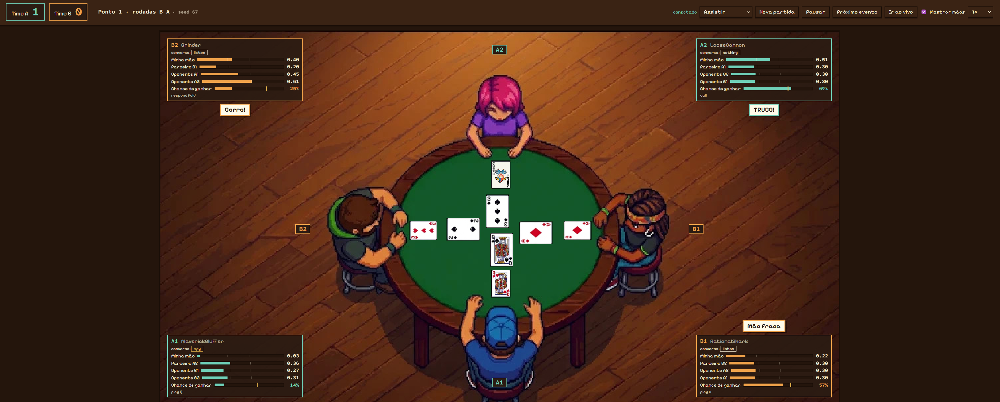

# Simulação de Truco Mineiro com Agentes BDI

**Disciplina**: CIC0190 - INTRODUÇÃO A SISTEMAS MULTIAGENTE - T01 <br>
**Nro do Grupo**: 05<br>
**Frente de Pesquisa**: Agentes BDI no Contexto de Truco Mineiro<br>

## Alunos
|Matrícula | Aluno |
| -- | -- |
| 23/1035393 | Lucas Saad Rodrigues    |
| 23/1018900 | Lucca Schoen de Almeida |
| 23/2006144 | Rafael Dias Ghiorzi     |

## Sobre

Este projeto é um sistema multiagente em que agentes com arquitetura **BDI** (*Belief–Desire–Intention*) jogam **Truco Mineiro** em duplas. Ele foi construído para responder a uma pergunta de pesquisa: **perfis de jogadores descritos na literatura de pôquer continuam fazendo sentido quando transpostos para o Truco?**

O pôquer tem uma literatura extensa sobre tipos de jogadores: o calculista, o blefador, o emocional, o cauteloso. O Truco compartilha os mesmos ingredientes (informação oculta, apostas que sobem, blefe e leitura do adversário), mas é jogado em duplas que trocam sinais, as apostas sobem em degraus fixos e a decisão de apostar convive com a de qual carta jogar. Por isso, ele é um bom caso para testar se esses perfis se transferem para outro jogo.

### Os agentes

O sistema é implementado em [SPADE](https://spade-mas.readthedocs.io/), e os agentes se comunicam por mensagens com performativas [FIPA-ACL](http://www.fipa.org/specs/fipa00061/). São três tipos de agente:

| Agente | Papel |
| -- | -- |
| **Mesa** (`TableAgent`) | Máquina de estados determinística de 8 estados que conduz a partida: distribui as cartas, pede as jogadas, valida as regras, abre e fecha a janela de conversa e conta os pontos. Se um jogador não responde em 15 s ou erra 3 vezes seguidas, a mesa decide por ele. |
| **Jogador** (`Player`) | Agente BDI. Todos usam as mesmas fórmulas de decisão (poder das cartas, crenças sobre a mão dos outros, chance de vencer e limites para correr e pedir truco). O que muda entre eles é a **personalidade**, um pequeno conjunto de parâmetros e regras. |
| **Blackboard** (`BlackboardAgent`) | Simula os sinais entre parceiros. Uma vez por mão, abre uma janela de conversa em que cada jogador escolhe uma ação: **enviar** um sinal ao parceiro, **escutar**, **espionar** a outra dupla, **blefar** com um sinal falso ou **não fazer nada**. A mesa nunca vê o que foi dito. |

### As personalidades

| Personalidade | Inspiração no pôquer | Papel no Truco |
| -- | -- | -- |
| **Rational Shark** | Bons jogadores assumem riscos calculados e modelam os adversários (Leonard & Williams, 2015) | O calculista: estima a chance sem distorção, explora quem corre demais e aprende quem pede truco sem ter mão |
| **Maverick Bluffer** | Enganar e reconhecer o engano são competências centrais (Leonard & Williams, 2015); o nome homenageia a categoria *maverick* (Radburn & Horsley, 2011) | O trucador: blefa com frequência e pede mais truco contra quem costuma correr |
| **Loose Cannon** | Emocionalidade e *tilt* (Laakasuo et al., 2014) | O esquentado: crédulo e impulsivo; depois de perder mãos, subestima os adversários e arrisca mais |
| **Grinder** | Lucro pequeno e regular a partir de vantagem estatística (Radburn & Horsley, 2011) | O cauteloso: superestima os adversários, guarda as cartas fortes e exige mais para aceitar e pedir |

Dois jogadores de controle sem deliberação servem de linha de base: o **Coward**, que nunca pede truco e corre de tudo, e o **Madman**, que pede truco sempre que recebe uma manilha e nunca corre.

### Principais resultados

Rodamos 700 partidas por configuração, com todas as personalidades se enfrentando dos dois lados da mesa e contra os controles.

- **As personalidades produzem comportamentos claramente distintos.** A taxa de pedido de truco vai de 44% (Maverick) a 10% (Grinder).
- **O significado do pôquer se transfere só em parte.** O *tilt* do Loose Cannon e a baixa variância do Grinder aparecem como esperado. Já o Maverick vence pelo volume de pedidos, e não pela eficiência do blefe, e o Rational Shark lê bem os adversários, mas não converte isso em vitórias.
- **O desempenho depende de como a mesa interpreta um pedido de truco.**
  - Quando o pedido soa como uma mão média, o cauteloso domina: o Grinder venceu 64% das partidas.
  - Quando soa como ameaça, vence quem aceita mais: o Loose Cannon venceu 65%.
  - Todas as personalidades BDI venceram os controles em pelo menos 89% das partidas.
- **A janela de conversa, tal como modelada, não muda o resultado das partidas.** Com e sem conversa, nenhuma taxa de vitória variou de forma conclusiva.

A metodologia completa e a discussão dos resultados estão no artigo do projeto.

### Modelagem

O sistema foi modelado com a metodologia **Tropos**:
- requisitos iniciais e finais em **iStar 2.0** (modelos SD e SR), feitos no [piStar](https://www.cin.ufpe.br/~jhcp/pistar/);
- protocolos de interação em **AUML**.

Os diagramas estão na pasta [`modelage/`](modelagem/). Os arquivos `.txt` abrem direto no piStar. abaixo temos exemplos:


**Interface web: acompanhando uma partida entre agentes**

<!-- TODO: adicionar print da mesa com as mãos e as ações de conversa -->


**Modelagem Late SD**


## Instalação

**Linguagens**: Python 3.14, JavaScript<br>
**Tecnologias**: SPADE 4 (agentes e servidor XMPP embutido), FIPA-ACL, FastAPI + WebSocket (backend da interface), React + Vite (frontend), uv (gerenciador de pacotes Python)<br>

### Pré-requisitos

- [Python 3.14+](https://www.python.org/downloads/)
- [uv](https://docs.astral.sh/uv/getting-started/installation/)
- [Node.js 18+](https://nodejs.org/), necessário apenas para a interface web

### Passo a passo

```bash
# 1. Clonar o repositório
git clone https://github.com/rafaelghiorzi/2026.2_G5_SMA_ProjetoTrucoMineiroBDI.git
cd 2026.2_G5_SMA_ProjetoTrucoMineiroBDI

# 2. Instalar as dependências Python (cria o ambiente virtual automaticamente)
uv sync
```

As dependências do frontend são instaladas automaticamente (`npm install`) na primeira vez que a interface é aberta.

Não é preciso instalar um servidor XMPP: o SPADE sobe um servidor embutido.

## Uso

O projeto pode ser usado de duas formas: pela **interface web**, para assistir a uma partida ou jogar contra os agentes, ou pela **linha de comando**, para rodar os lotes de simulação usados no artigo.

### 1. Interface web

```bash
uv run truco-dev
```

Esse comando sobe o backend (servidor XMPP, agentes e FastAPI na porta 8000) e o frontend (Vite na porta 5173). Abra **http://localhost:5173** no navegador.

- Clique em **Nova partida** para sortear quatro personalidades e assistir à partida.
- Na mesa aparecem as cartas de cada jogador, as ações escolhidas na janela de conversa, os pedidos de truco e o raciocínio de cada agente.
- Também é possível ocupar um dos assentos e **jogar contra os agentes**. Nesse caso, a interface pede sua jogada, sua resposta aos pedidos de truco e sua ação na janela de conversa.

`Ctrl+C` encerra o backend e o frontend juntos. Para subir apenas o backend, use `uv run truco-server`.

<!-- TODO: GIF de uma partida sendo jogada -->

### 2. Simulações em lote

```bash
uv run truco                          # roda a configuração definitiva
uv run python -m truco.main original  # roda uma ou mais condições pelo nome
```

Cada condição joga todos os confrontos entre personalidades BDI e entre cada BDI e cada controle, com 25 partidas por lado (700 partidas no total). As sementes são fixas, então os resultados são reprodutíveis.

As condições estão definidas em [`src/truco/experiments.py`](src/truco/experiments.py):

| Condição | O que é |
| -- | -- |
| `original` | Protótipo: o pedido de truco é ouvido como uma mão forte |
| `recalibrado` | Configuração **inicial** do artigo: perfis traduzidos diretamente do pôquer |
| `calib_*`, `calib2_*`, `calib3_*`, `calib4_a` | Condições de calibração (só confrontos entre BDI, com menos partidas) |
| `definitiva` | Configuração **final**, usada nos resultados do artigo |

Os eventos de cada partida (cartas, pedidos, respostas, ações na conversa e vencedores) são gravados em `results/events_<condição>.csv`. Se o lote for interrompido, ele retoma de onde parou. Os logs legíveis de cada partida ficam em `match_logs/`.

### Estrutura do código

```
src/
├── truco/
│   ├── agents/
│   │   ├── table.py        # Mesa: máquina de estados que conduz a partida
│   │   ├── blackboard.py   # Blackboard: janela de conversa
│   │   ├── player.py       # Jogador BDI e as quatro personalidades
│   │   ├── control.py      # Jogadores de controle (Coward e Madman)
│   │   ├── human.py        # Jogador humano (via interface web)
│   │   └── spectator.py    # Espectador que repassa os eventos à interface
│   ├── config.py           # Regras, baralho, parâmetros e vocabulário FIPA
│   ├── communication.py    # Montagem e leitura das mensagens FIPA-ACL
│   ├── game.py             # Cartas, rodadas e pontuação
│   ├── experiments.py      # Condições experimentais
│   ├── metrics.py          # Registro de eventos em CSV
│   ├── main.py             # Lotes de simulação
│   ├── server.py           # Backend da interface (FastAPI + WebSocket)
│   └── dev.py              # Sobe backend e frontend juntos
└── frontend/               # Interface web (React + Vite)
```

## Vídeo

<!-- TODO: substituir pelo link do vídeo -->
O vídeo de apresentação do projeto pode ser acessado pelo
[link de apresentação](https://youtu.be/mYIJ5SbbjMo?is=MCpIn7h3QI-WKG0B)

## Artigo

O projeto foi descrito e sua análise foi reportada em um artigo que pode ser acessado na [documentação](docs/artigo_truco_isma.pdf)

## Participações

|Nome do Membro | Contribuição | Significância da Contribuição para o Projeto (Excelente/Boa/Regular/Ruim/Nula) | Comprobatórios (ex. links para commits)
| -- | -- | -- | -- |
| Lucas Saad Rodrigues | Agente Blackboard, estado de conversa da mesa, servidor FastAPI/WebSocket, agente espectador e interface web (React) com exibição das mãos, das ações de conversa e do raciocínio dos agentes | Excelente | [Blackboard como FSM](https://github.com/rafaelghiorzi/2026.2_G5_SMA_ProjetoTrucoMineiroBDI/commit/780c946), [janela de conversa](https://github.com/rafaelghiorzi/2026.2_G5_SMA_ProjetoTrucoMineiroBDI/commit/88b3286), [servidor](https://github.com/rafaelghiorzi/2026.2_G5_SMA_ProjetoTrucoMineiroBDI/commit/21b3d22), [interface](https://github.com/rafaelghiorzi/2026.2_G5_SMA_ProjetoTrucoMineiroBDI/commit/8138da5), [raciocínio na mesa](https://github.com/rafaelghiorzi/2026.2_G5_SMA_ProjetoTrucoMineiroBDI/commit/bdca898) |
| Lucca Schoen de Almeida | Modelo de cartas e baralho, crenças e receita de decisão BDI, modificadores por personalidade, decisões de pedir, responder e declarar, jogadores de controle, métricas, lotes de simulação, modelagem de adversários do Shark, *tilt* do Loose Cannon e toda a calibração até a configuração definitiva | Excelente | [crenças](https://github.com/rafaelghiorzi/2026.2_G5_SMA_ProjetoTrucoMineiroBDI/commit/9eb12bd), [receita de decisão](https://github.com/rafaelghiorzi/2026.2_G5_SMA_ProjetoTrucoMineiroBDI/commit/9984f52), [personalidades](https://github.com/rafaelghiorzi/2026.2_G5_SMA_ProjetoTrucoMineiroBDI/commit/cca7f59), [controles](https://github.com/rafaelghiorzi/2026.2_G5_SMA_ProjetoTrucoMineiroBDI/commit/42560f3), [lotes e métricas](https://github.com/rafaelghiorzi/2026.2_G5_SMA_ProjetoTrucoMineiroBDI/commit/2ceb5e6), [configuração definitiva](https://github.com/rafaelghiorzi/2026.2_G5_SMA_ProjetoTrucoMineiroBDI/commit/325a6e2) |
| Rafael Dias Ghiorzi | Especificação inicial, estrutura do projeto com uv e SPADE, regras do jogo, agente Mesa (máquina de estados), pedido de truco na mesa, vocabulário FIPA centralizado, comunicação cíclica do blackboard, logging, sementes, modelagem Tropos (iStar e AUML) e redação do artigo | Excelente | [especificação](https://github.com/rafaelghiorzi/2026.2_G5_SMA_ProjetoTrucoMineiroBDI/commit/99ac76f), [regras](https://github.com/rafaelghiorzi/2026.2_G5_SMA_ProjetoTrucoMineiroBDI/commit/ca5269d), [mesa](https://github.com/rafaelghiorzi/2026.2_G5_SMA_ProjetoTrucoMineiroBDI/commit/3f2e415), [pedido de truco](https://github.com/rafaelghiorzi/2026.2_G5_SMA_ProjetoTrucoMineiroBDI/commit/f03474a), [comunicação do blackboard](https://github.com/rafaelghiorzi/2026.2_G5_SMA_ProjetoTrucoMineiroBDI/commit/4687eb2), [modelagens](https://github.com/rafaelghiorzi/2026.2_G5_SMA_ProjetoTrucoMineiroBDI/commit/371e27b) |

## Outros

### Lições aprendidas

- **Comportamento de agente depende do ambiente.** O mesmo perfil cauteloso foi o melhor ou o pior jogador dependendo apenas de como um pedido de truco é interpretado. Calibrar um único parâmetro mudou a hierarquia inteira.
- **Separar a decisão da personalidade compensa.** Como todos os agentes usam as mesmas fórmulas e diferem só em parâmetros, foi possível isolar o efeito de cada traço e recalibrar sem reescrever o código.
- **Comunicação assíncrona exige cuidado com falhas.** Prazos, novas tentativas e decisões padrão na mesa e no blackboard foram necessários para que nenhuma partida travasse.
- **Simulações precisam ser reprodutíveis.** As sementes fixas permitiram comparar configurações com exatamente as mesmas cartas e repetir qualquer resultado.

### Percepções

- O paradigma BDI se encaixou bem num jogo de informação oculta: as crenças sobre a mão dos outros são o centro de todas as decisões.
- O SPADE simplificou a infraestrutura (servidor XMPP embutido, comportamentos e máquinas de estados prontos). Em troca, o desempenho das simulações ficou limitado pela troca real de mensagens.

### Contribuições e fragilidades

**Contribuições:**
- um sistema multiagente para o Truco Mineiro que modela explicitamente os sinais e o blefe entre jogadores;
- uma forma de traduzir perfis da literatura de pôquer em agentes BDI com parâmetros explícitos;
- uma avaliação experimental reprodutível de 700 partidas por configuração.

**Fragilidades:**
- os parâmetros foram definidos pelos autores e ajustados por simulação, e não estimados a partir de jogadores reais;
- a calibração buscou uma hierarquia desejada, então o desempenho da configuração final não é um teste independente;
- as amostras da calibração são pequenas;
- a comunicação foi reduzida a uma ação por mão, muito mais pobre que os gestos do jogo real;
- os agentes tratam as declarações públicas, que são sempre verdadeiras, com a mesma confiança que os sinais.

### Trabalhos futuros

- Estimar os parâmetros a partir de partidas com pessoas, usando a interface web, que já permite jogadores humanos.
- Comparar os perfis simulados com jogadores reais.
- Estender o modelo a outras variantes, como o Truco Paulista, em que as manilhas mudam a cada mão.
- Enriquecer a comunicação, com sinais ao longo da mão e confiança diferente para cada fonte de informação.

## Fontes

### Referências do projeto

- BRATMAN, M. E. *Intention, Plans, and Practical Reason*. Cambridge: Harvard University Press, 1987.
- BRESCIANI, P. et al. Tropos: An Agent-Oriented Software Development Methodology. *Autonomous Agents and Multi-Agent Systems*, v. 8, n. 3, p. 203–236, 2004.
- DALPIAZ, F.; FRANCH, X.; HORKOFF, J. *iStar 2.0 Language Guide*. arXiv:1605.07767, 2016.
- FIPA. *FIPA ACL Message Structure Specification* (SC00061G). Foundation for Intelligent Physical Agents, 2002.
- LAAKASUO, M. et al. Experienced Poker Players Are Emotionally Stable. *Cyberpsychology, Behavior, and Social Networking*, 2014.
- LEONARD, C. A.; WILLIAMS, R. J. Characteristics of Good Poker Players. *Journal of Gambling Issues*, 2015.
- McLEOD, J. Truco (Brazil). *Card Games Website (pagat.com)*. Disponível em: https://www.pagat.com/put/truco_br.html.
- NII, H. P. Blackboard Systems. *AI Magazine*, v. 7, n. 2–3, 1986.
- PALANCA, J. et al. SPADE 3: Supporting the New Generation of Multi-Agent Systems. *IEEE Access*, v. 8, 2020.
- PATEL, P.; HEXMOOR, H. Designing BOTs with BDI Agents. *International Symposium on Collaborative Technologies and Systems*, 2009.
- RADBURN, B.; HORSLEY, R. Gamblers, Grinders, and Mavericks: The Use of Membership Categorisation to Manage Identity by Professional Poker Players. *Journal of Gambling Issues*, 2011.
- RAO, A. S.; GEORGEFF, M. P. BDI Agents: From Theory to Practice. *Proceedings of the First International Conference on Multi-Agent Systems (ICMAS)*, 1995.
- SILER, K. Social and Psychological Challenges of Poker. *Journal of Gambling Studies*, v. 26, n. 3, p. 401–420, 2010.
- VARGAS, D. P. et al. Active Learning and Case-Based Reasoning for the Deceptive Play in the Card Game of Truco. *Intelligent Systems (BRACIS)*, LNCS 13073, p. 313–327, 2021.
- YOO, J.; LEE, J. An Intelligent Non-Player Character Based on BDI Agent. 2008.

### Leitura complementar

- WOOLDRIDGE, M. *An Introduction to MultiAgent Systems*. 2. ed. Wiley, 2009.
- [Documentação do SPADE](https://spade-mas.readthedocs.io/)
- [piStar: ferramenta de modelagem iStar](https://www.cin.ufpe.br/~jhcp/pistar/)

## IA Generativa

O grupo usou IA generativa como ferramenta de apoio, sempre com revisão e decisão final dos integrantes:

- **Modelagem:** o modelo serviu como inspiração para os modelos iStar e os diagramas AUML, que depois foram ajustados pelo grupo no piStar.
- **Artigo:** apoio na revisão textual, checagem de consistência dos fatoes entre texto, tabelas e código, e na tradução para o inglês.
- **Código:** apoio no desenvolvimento utilizando o framework SPADE, a partir da modelagem feita pelo grupo.
<!-- TODO: completar se a IA também foi usada no código (por exemplo, em funções, revisão ou depuração), indicando onde. -->

Todo o conteúdo gerado com apoio de IA foi conferido pelo grupo contra o código e os dados das simulações.